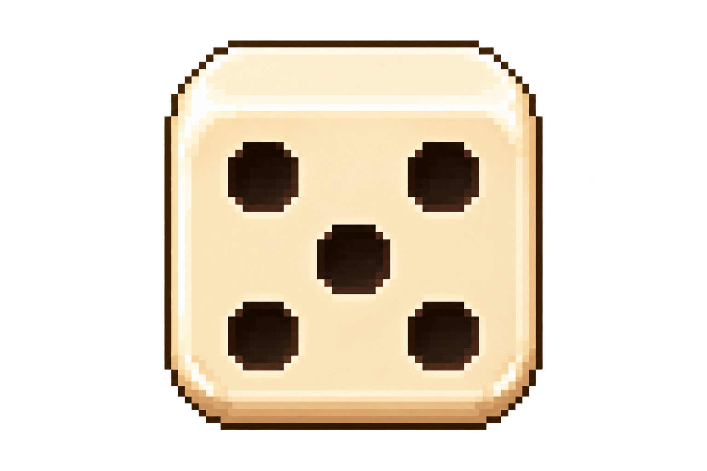
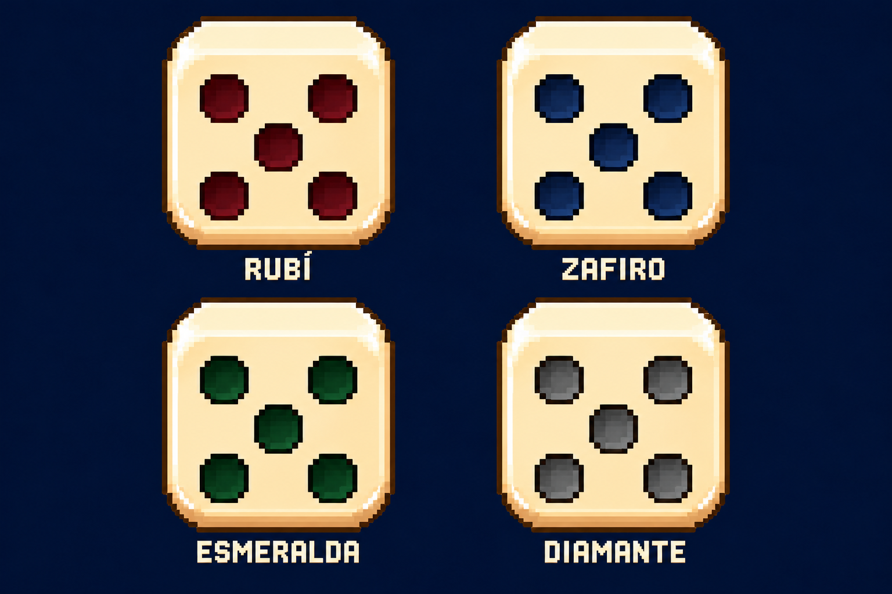

> Decisión posterior vigente, 28/10/2026: gemas brillantes; materiales y elementos frontales, sin dibujitos inferiores. Integración actual: [Dados compuestos](DADOS-COMPUESTOS.md). Las aprobaciones anteriores se conservan debajo como historial.

# Diseño maestro de todos los dados — v1

**CONFIRMADO por el autor el 27 de octubre de 2026.** Fuente: aprobación explícita de la muestra adjunta en este chat: «necesito que todos los diseños de los dados del juego sean con ese diseño que me pasaste. Fijalo en el PRD».

## Acabado de puntos de gema aprobado

**CONFIRMADO por el autor el 27 de octubre de 2026:** «exacto, ese diseño me encanta. Conservalo». La aprobación corresponde a la segunda comparación, con los cuatro colores apagados y sin brillo; sustituye la muestra anterior con destellos y facetas brillantes.

Archivo intacto: `assets/art/dice-master-v1/puntos-gema-mate-aprobados.png`. SHA-256: `458FFA77EA8F6554C4140D306B0F9533566799F56F1398AA25F8A78F9739AEBB`.

- **Rubí:** rojo oscuro/bordó apagado.
- **Zafiro:** azul oscuro apagado.
- **Esmeralda:** verde oscuro apagado.
- **Diamante:** gris opaco con borde oscuro para conservar contraste.
- **Todos:** puntos mates, opacos y hundidos, con sombreado suave semejante al punto negro. Sin destellos blancos, reflejos especulares, transparencia, resplandor ni aspecto de joya pulida. El relieve sigue siendo legible.
- **Cuerpo:** mismo marfil cálido, perspectiva y silueta del maestro; solo cambia el material visual de los puntos.

Estos cuatro acabados ya están aprobados como referencia artística. No volver a generar una versión brillante ni alterar la paleta sin una nueva decisión del autor. Las caras restantes y estados de daño se derivan de esta referencia. La comparación original se conserva intacta; sus treinta caras derivadas ya están integradas mediante los recursos de `dice-faces-v1`.

## Referencia obligatoria

**Cambio posterior confirmado por el autor — 27 de octubre de 2026:** las mejoras antes llamadas carcasas se representan en el **material de los puntos**. Negro es el material/color base. Esmeralda, rubí, zafiro y diamante modifican visualmente los puntos, no recubren ni recolorean el cuerpo. Se conservan sus mejoras actuales; es un cambio de representación y terminología. El material del cuerpo (acero/cobre) y el elemento siguen siendo familias independientes.

Archivo maestro: `assets/art/dice-master-v1/dado-base-aprobado-5.png`. Es la imagen adjunta aprobada por el usuario, copiada sin modificar sus píxeles. SHA-256: `A5BA4D80176E9DA68C8FBB4C5CF136468C2CA27FEA574F54ECED96D1E41F66C0`.

La imagen fija **el diseño de todos los dados**, no solo el aspecto de una oferta o una ilustración aislada. Las referencias anteriores quedan superadas donde contradigan esta dirección.

## Reglas visuales confirmadas

1. **Perspectiva:** dado casi frontal, visto ligeramente desde arriba. La cara frontal es grande y casi cuadrada; se ve una franja superior corta. No usar un cubo isométrico girado, una cara superior dominante ni una cara lateral amplia.
2. **Forma:** mismo cuerpo grueso, proporciones, silueta, esquinas redondeadas y biseles escalonados del maestro. Mantener la cámara y orientación entre variantes; no regenerar una geometría diferente para cada componente.
3. **Paleta base:** marfil/crema cálido, luces blanco manteca, bisel beige/miel y sombras marrones cálidas, como la imagen aprobada. Esta paleta sustituye el tinte rosado del ejemplo de fuego anterior y los blancos fríos ajenos a la referencia.
4. **Puntos:** negros en el dado base, hundidos y con borde de relieve, conservando tamaño, posición y forma del maestro. Una mejora de gema cambia su material/color/acabado: esmeralda, rubí, zafiro o diamante. El cambio afecta solo a los puntos y no recolorea el cuerpo. El resultado se lee en la cara frontal; la parte superior visible no muestra un segundo resultado que pueda confundirse con el número jugable. Incluso en acabados claros, el contorno y el relieve deben conservar el contraste.
5. **Estilo:** pixel art cuidado, con grupos de píxeles deliberados, volumen y biseles legibles. Mantener coherencia con el club, vaso, mate, monedas y referencia de tienda. No sustituir por vectores planos, cubos geométricos simples ni render 3D de otra estética.
6. **Variantes:** material del cuerpo, material de los puntos, elementos y daño conservan perspectiva, silueta y proporciones. El cuerpo representa su material propio; las gemas representan el material de los puntos; el elemento añade su señal independiente. No producir cubos enteros de gema para representar la familia antes llamada carcasa. La aprobación del maestro no aprueba automáticamente cada acabado o adorno futuro.
7. **Estados e interfaz:** la misma dirección rige en mesa, reserva, grupos, vaso, inventario, tienda, fichas y previsualizaciones. Selección, foco, bloqueo y grietas no tapan los puntos ni alteran su cantidad.
8. **Resultados exactos:** las caras 1–6 conservan la distribución convencional de puntos; cambiar el número no cambia el diseño. Una oferta de cara representa el número que vende. Ninguna ilustración modifica caras, probabilidades o reglas.

## Catálogo cubierto

| Familia | Variantes actuales | Condición artística |
|---|---|---|
| Base | Caras 1, 2, 3, 4, 5 y 6 | Mismo cuerpo/perspectiva/paleta; el cinco maestro está aprobado |
| Materiales | Acero, cobre | Acabados derivados del maestro, sin cubos isométricos distintos |
| Material de los puntos | Negro base; esmeralda, rubí, zafiro, diamante como mejoras | Cambia material/color/acabado de los puntos, conservando cuerpo, silueta y distribución |
| Elementos | Fuego, agua, tierra, viento, electricidad | Señal elemental sobre el mismo dado; puntos siempre legibles |
| Daño | Los cuatro materiales de puntos mejorados, dañados | La señal de daño corresponde a los puntos; no agrieta el cuerpo, elimina puntos ni altera su cantidad |
| Combinaciones | Material del cuerpo + material de los puntos + elemento | Familias independientes; esta decisión no elimina la coexistencia de componentes |
| Futuras variantes | Catálogo que se autorice después | Obligadas al mismo diseño salvo nueva decisión explícita del autor |

Los cuatro acabados mates de la comparación anterior ya fueron aprobados expresamente. Los acabados adicionales aún no mostrados y sus estados de daño siguen siendo trabajo artístico pendiente. No se registra otra variante como aprobada solo porque se haya generado.

## Poder, riesgo y reparación conservados

El usuario confirma que las mejoras quedan y el cambio es visual para los puntos. Se conservan los efectos y condiciones vigentes de esmeralda, rubí, zafiro y diamante, incluida su activación, suspensión, riesgo y reparación. El daño desactiva el poder de esa gema y se repara con las reglas actuales; ahora se representa como daño del material de los puntos. No vuelve negros los puntos por perder el equipamiento: la identidad mejorada sigue presente y se señala su estado. El dado, sus caras y la cantidad de puntos dibujados permanecen intactos.

No renombrar las claves persistidas `shell`, `shell_broken`, fuentes `shell:*` ni las ofertas internas solo por este cambio artístico. Se documentan como alias técnicos heredados de la familia de material de puntos; una migración solo sería necesaria si una implementación posterior cambia el contrato de datos. Documentar esta equivalencia no declara que la interfaz o los sprites ya hayan sido actualizados.

## Conservación y estado

**Avance posterior — caras integradas:** generadas las caras 1–6 en negro, rubí, zafiro, esmeralda y diamante; treinta en total, conservadas en ambos PRD y aplicadas a mesa/tienda. Galería desde menú/Opciones. 2101 comprobaciones, cero fallos. [Catálogo, archivos, límites y verificación](CARAS-DE-DADOS.md).

Referencias actualizadas en Notion: [PRD general, dirección de arte](https://app.notion.com/p/3fec28142b55815c9f84c21402b73154) y [PRD-PROTOTIPO, contenido confirmado](https://app.notion.com/p/404c28142b5581679265d602cec7e69b). La imagen se subió y se adjuntó de forma nativa en ambas páginas; no es un enlace a una carpeta temporal.

- Imagen fuente aprobada preservada dentro del proyecto y adjunta en el PRD de Notion.
- Decisión registrada en la dirección de arte del PRD general y enlazada desde PRD-PROTOTIPO.
- Las copias fechadas en `docs/fuentes/` son históricas y no se reescriben. Este documento y las reglas vigentes contienen la decisión posterior.
- **Estado actual:** caras negras y de gema integradas y preservadas; maestros aprobados intactos. Las variantes de material del cuerpo/elementos y el resto del pase artístico siguen pendientes. La tabla de tienda usa las caras nuevas para ofertas de gema/cambio de cara; otros iconos conservan su alcance pendiente.

